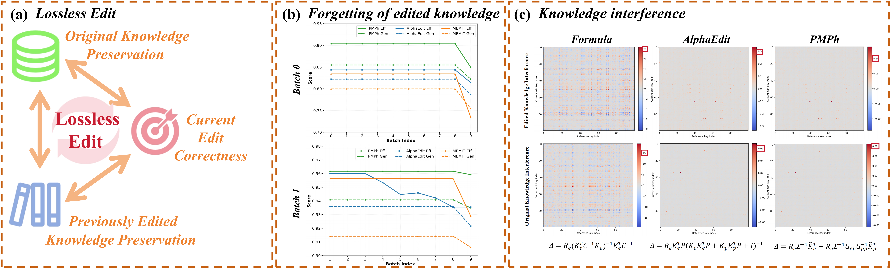

# PMPh
- Code for [``From Soft Penalties to Hard Constraints: Achieving Near Lossless Sequential Knowledge Editing with Projected Minimal Perturbation``]


*Figure: Illustration of knowledge interference in sequential knowledge editing and the effectiveness of the proposed PMPh framework. (a) An ideal lossless edit requires simultaneously satisfying three conditions: correctness of the current edit, preservation of previously edited knowledge, and preservation of original pretrained knowledge. (b) In practice, existing methods exhibit noticeable forgetting of earlier edits as sequential updates accumulate. (c) Knowledge interference analysis. Sequential updates introduce interference between newly edited knowledge and both original and previously edited knowledge, leading to performance degradation.*

## Requirements
**At least one A40 48G GPU.**

- torch==2.6.0
- einops==0.8.1
- higher==0.2.1
- hydra-core==1.3.2
- transformers==4.51.3
- datasets==2.21.0
- matplotlib==3.10.3
- spacy==3.4.1
- scipy==1.15.2
- scikit-learn==1.6.1
- nltk==3.9.1

## Quick Start
### An example for editing Llama3 (8B) on counterfact dataset using PMPh
#### 1. Edit Llama3 (8B) model 

    python3 -m experiments.evaluate     --alg_name=PMPh     --model_name=meta-llama/Meta-Llama-3-8B-Instruct     --hparams_fname=Llama3-8B.json --ds_name=mcf --dataset_size_limit=2000    --num_edits=100 --downstream_eval_steps=5

This command runs an evaluation script for the PMPh algorithm using the Llama3-8b-instruct. Below are the explanations for each argument:

- `--alg_name=PMPh`: Specifies the name of the algorithm being used, which is PMPh in this case.
- `--model_name=meta-llama/Meta-Llama-3-8B-Instruct`: Indicates the name of the model being evaluated, here it is Llama-3-8B-Instruct.
- `--hparams_fname=Llama3-8B.json`: Points to the JSON file containing hyperparameters specific to the Llama-3-8B-Instruct model.
- `--ds_name=mcf`: Specifies the dataset name, in this case, "mcf".
- `--dataset_size_limit=2000`: Sets the total number of editing samples to 2000.
- `--num_edits=100`: Defines the batch size for each round of editing, meaning 100 edits will be performed in each batch. 
- `--downstream_eval_steps=5`: indicates that a test of general capabilities is conducted after every 5 rounds of editing.

Results from each run are stored at `results/<method_name>/run_<run_id>` in a specific format:
```bash
results/
|__ PMPh/
    |__ run_<run_id>/
        |__ params.json
        |__ case_0.json
        |__ case_1.json
        |__ ...
        |__ case_2000.json
```

#### 2. Summarize the results  
To summarize the results, you can use [`experiments/summarize.py`](experiments/summarize.py):

    python summarize.py --dir_name=PMPh --runs=run_<run1>,run_<run2>

## Acknowledgment
Our code is based on  [``AlphaEdit``](https://github.com/jianghoucheng/AlphaEdit.git).
